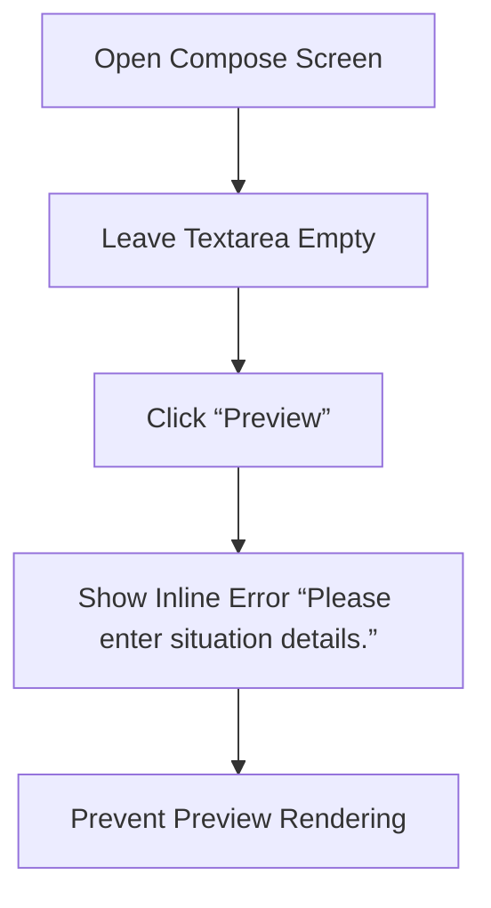
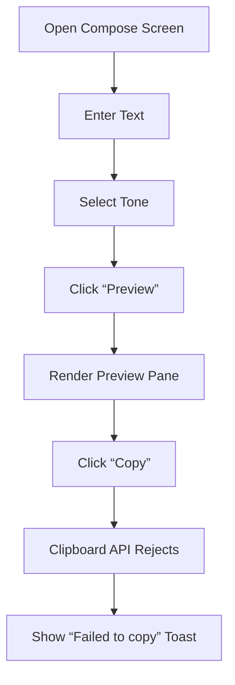
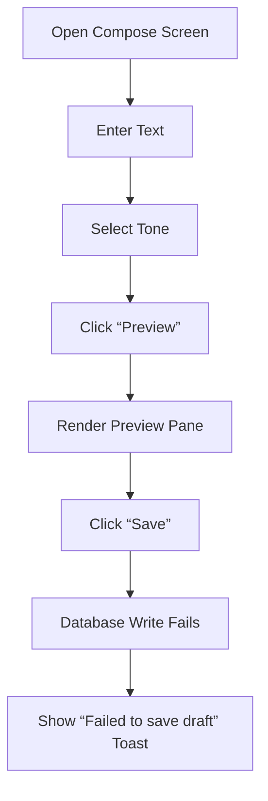
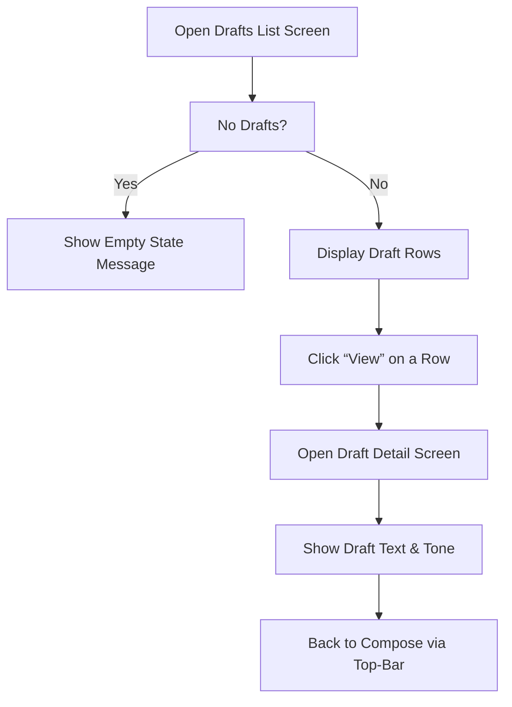

# User Flows

## Overview

The Smelly Cat v1 application supports a single linear user journey for composing a respectful message about an unpleasant odor, with optional preview, copy, and draft‑saving actions.
All flows are derived from the approved SRS and trace to the following requirement IDs:

- **US‑01** – Compose a message
- **US‑02** – Preview the message
- **US‑03** – Copy the message to the clipboard
- **US‑04** – Save a draft locally
- **US‑05** – View saved drafts
- **FR‑07** – Validate non‑empty input
- **FR-09** – Handle clipboard failures
- **FR-09** – Handle persistence failures

The following diagrams and step lists capture the primary flow and all relevant alternative paths.

---

## Primary Flow – Compose → Preview → Copy → Save

```mermaid
flowchart TD
    A[Open Compose Screen] --> B[Enter Situation Details]
    B --> C[Select Tone (Friendly/Formal)]
    C --> D[Click “Preview”]
    D -->|Valid Input| E[Render Preview Pane]
    E --> F[Click “Copy”]
    F --> G[Show “Copied!” Toast]
    E --> H[Click “Save”]
    H --> I[Persist Draft]
    I --> J[Show “Draft saved” Toast]
    J --> K[Navigate to Drafts List]
```

**Step‑by‑step description**

| Step | Action | Validation | Outcome | Requirement ID |
|------|--------|------------|---------|----------------|
| 1 | User opens the **Compose** screen (default landing page). | – | Screen displayed. | US‑01 |
| 2 | User types non‑empty text into the textarea. | – | Text captured. | US‑01 |
| 3 | User selects a tone via radio buttons (default “Friendly”). | – | Tone stored. | US‑02 |
| 4 | User clicks **Preview**. | **FR‑07** – textarea must contain non‑empty, non‑whitespace text. | If valid, preview pane renders the composed message. If invalid, inline error “Please enter situation details.” appears. | US‑02 |
| 5 | User clicks **Copy**. | **FR‑04** – preview must exist. | Clipboard API invoked. | US‑03 |
| 6 | Clipboard API succeeds → toast “Copied!” appears. | – | Toast auto‑dismisses after 3 s. | AC‑03 |
| 7 | User clicks **Save**. | **FR‑04** – preview must exist. | Draft persisted to local storage. | US‑04 |
| 8 | Persistence succeeds → toast “Draft saved” appears. | – | Toast auto‑dismisses after 3 s. | AC‑05 |
| 9 | User navigates to **Drafts** via top‑bar link. | – | Drafts list screen displayed. | US‑05 |

---

## Alternate Flow – Validation Failure (Empty Input)



**Key points**

- The preview pane remains hidden.
- The **Copy** and **Save** buttons stay disabled.
- The error message is associated with the textarea (`aria-invalid="true"`).
- Requirement IDs: **FR‑07**, **AC‑02**.

---

## Alternate Flow – Clipboard Failure



**Key points**

- The toast is styled as an error (red background).
- The preview remains unchanged.
- Requirement IDs: **FR-09**, **AC‑04**.

---

## Alternate Flow – Persistence Failure



**Key points**

- The draft is not added to the list.
- The user can retry saving after correcting any underlying issue.
- Requirement IDs: **FR-09**, **AC‑06**.

---

## Alternate Flow – View Drafts



**Key points**

- The **Draft Detail** screen is read‑only; no copy or save actions are available.
- The empty state message is shown when the draft list is empty.
- Requirement IDs: **FR‑06**, **US‑05**.

---

## Summary of Flow‑to‑Requirement Mapping

| Flow | Key Requirement IDs |
|------|---------------------|
| Primary Compose Flow | US‑01, US‑02, US‑03, US‑04, US‑05, FR‑07, AC‑03, AC‑05 |
| Validation Failure | FR‑07, AC‑02 |
| Clipboard Failure | FR-09, AC‑04 |
| Persistence Failure | FR-09, AC‑06 |
| Drafts List & Detail | FR‑06, US‑05 |

These flows collectively cover all user interactions defined in the approved SRS, ensuring that every action, validation, and error state is represented and traceable.
